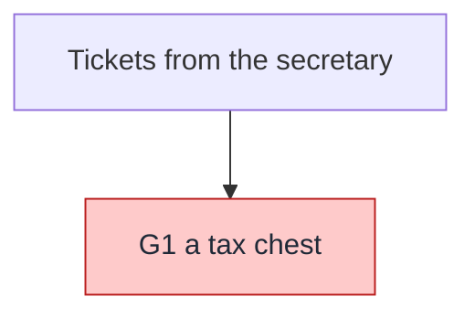

# A run's page, on your own PC

**elin-closeout** publishes the page as a Claude Artifact. This does the same job anywhere: everything here is a Markdown file, a Python
script and a browser. The page is one HTML file with no script and nothing to install, and it stays in `runs/pages/` (gitignored), so
it's yours to keep or share.

## 1. Write the summary

`runs/<run>-summary.md` (`<run>` is the log's name, like `2026-11-04-41`). Keep this shape, because the script reads it (**elin-closeout**
section 4 has the detail):

````markdown
# Run 41 summary: CHARACTER, level A to B (DATE, what kind of run)

The short version of the run, in one paragraph: the page's opening.

| | Start of run 41 | End of run 41 |
|---|---|---|
| Character level | 1 | 2 |
| Deaths / lowest HP | | 0 / 6 of 10 |

## Goals

| Goal | Set by | Status |
|---|---|---|
| G1 A tax chest at home | the player (first run) | open: 3 of 13 tickets |
| G2 A sleeping bag | the player (first run) | **done 485-06-01**: slept on the road |

## What was achieved in the game

- **What mattered:** one line each.

## The open goal chains



## Next session

1. **Start:** the routine, then at most three goal items plus upkeep.
````

Numbers come from the run's own log and `tools/score.py`; never guess one. A status starting `**done ...**` or `open:` becomes the
goal's pill. A table column whose separator is `---:` is right-aligned as numbers.

## 2. Render it

```bash
python -I tools/summary_page.py runs/<run>-summary.md --standalone
```

It writes `runs/pages/<run>-summary.html` and prints how many diagrams it drew. **Without `--standalone` the diagrams stay as Mermaid
source**, for a host that draws them. Fonts load from Google when online and fall back to the system's when not; the page works either way.

The diagrams are drawn by `tools/flowsvg.py`, which handles:

- `flowchart TB`, `TD`, `BT`, `LR` or `RL`
- nodes `id["text"]`, `id[("text")]` (a cylinder), `id("text")` (rounded) and `id{{"text"}}` (a hexagon), with `<br/>` for a line break
- links `a --> b`, `a -.-> b` (dotted), `a -- "text" --> b`, `a -. "text" .-> b`, `a ~~~ b` (spacing only), and chains `a --> b --> c`
- `classDef name fill:#...,stroke:#...,color:#...` and `class a,b name`
- comment lines `%% legend: name=meaning; other=meaning` and `%% note: text`, which become the key under the diagram

Anything else (`subgraph`, say) isn't drawn: the script says so and shows that diagram's source. Rewrite it in the list above. To check
files without rendering: `python -I tools/flowsvg.py runs/<run>-summary.md`.

## 3. Look at it

Open the file in a browser (`start runs/pages/<run>-summary.html` on Windows) and read it to the end: every diagram, and a wide table
scrolls sideways. If you can't see a browser, take the picture below and read that. Fix what doesn't read in the `.md`, never in the
HTML, and render again. Say plainly if you couldn't check it.

## 4. A picture of it (optional)

Any Chromium browser can do this with no window, in a throwaway profile so the player's own is untouched:

```bash
"/c/Program Files/Google/Chrome/Application/chrome.exe" --headless=new --disable-gpu --hide-scrollbars --no-first-run \
  --user-data-dir="$TEMP/elin-shot" --window-size=1280,1600 --virtual-time-budget=8000 \
  --screenshot="$(cygpath -w "$PWD/runs/pages/shot.png")" "file:///$(cygpath -m "$PWD")/runs/pages/<run>-summary.html"
```

In Git Bash, put `MSYS_NO_PATHCONV=1` in front of it. Make the window taller for a longer page. Microsoft Edge takes the same flags
(`/c/Program Files (x86)/Microsoft/Edge/Application/msedge.exe`).

Before sharing a picture, look at it: a page can hold clock times and anything else the summary says. **Never share a capture of the game
itself:** Ylvapedia's copyright page says the distribution of in-game media is prohibited by Noa(Lafrontier). Pictures of these pages are fine.

## 5. The numbers without the dashboard

The tracker in **elin-closeout** is a Claude Artifact too. The same numbers are plain files:

```bash
python -I tools/stats.py      # joins the logs into runs/stats.csv and runs/activity_rates.csv
python -I tools/score.py 10   # the last 10 runs' points by what earned them
```

Until the first tax bill is in `runs/bills.csv` the score leaves its gold column and rating blank: it has nothing to price gold by yet.
