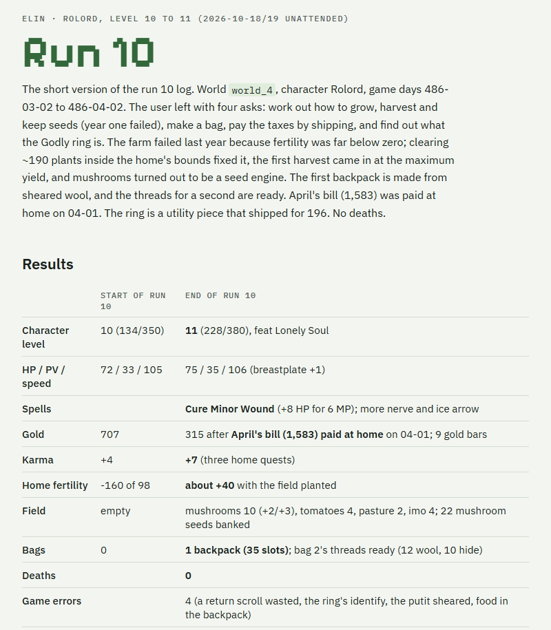
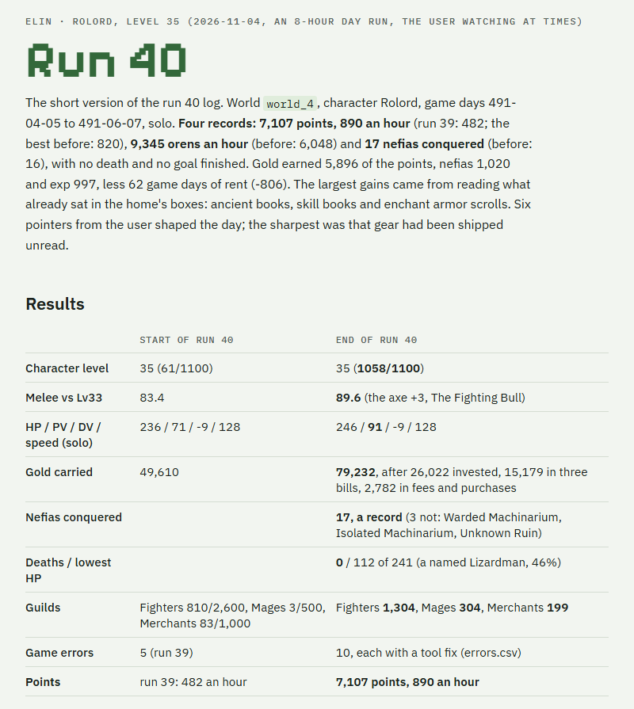
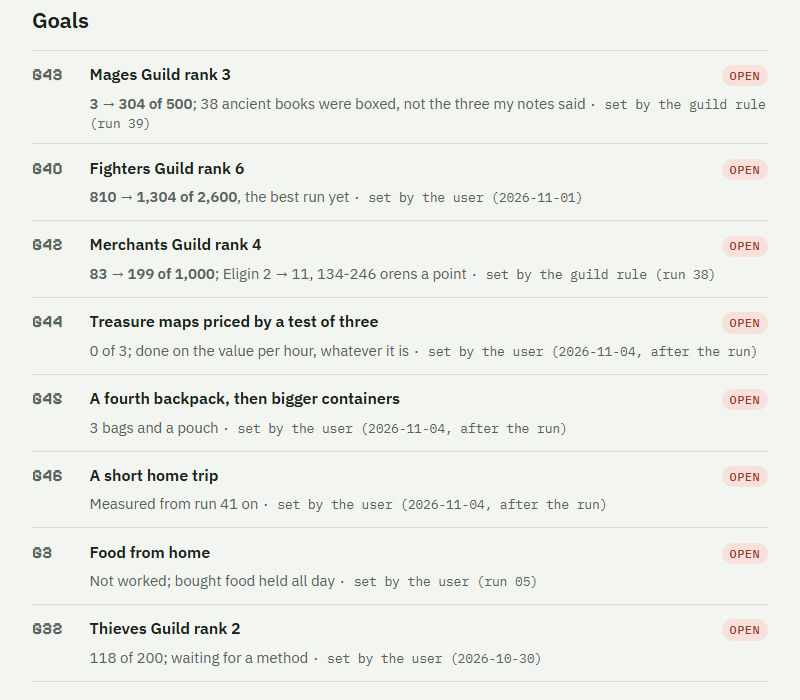
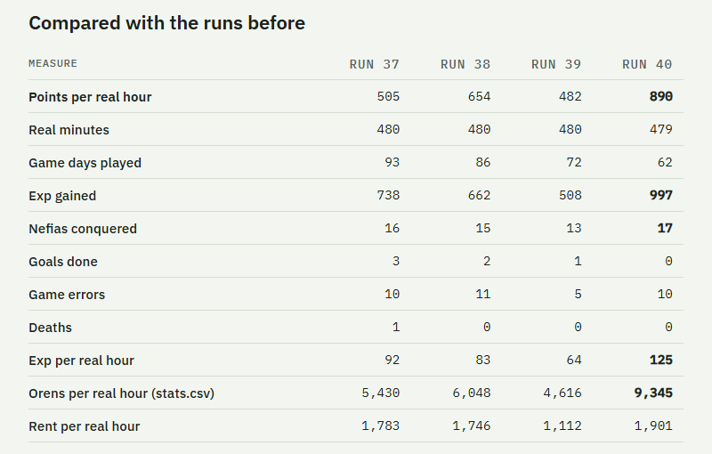
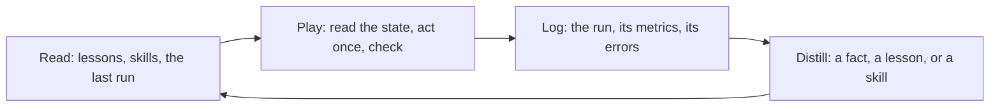

# elin-autoplay

Claude plays [Elin](https://store.steampowered.com/app/2135150/) (a roguelike in Steam Early Access, the successor to Elona), records what happens, distills lessons from each session, and uses them the next time it plays. I built this for fun, around one question: how good can Claude get at Elin?

This is not a scripted bot. The aim is measurable improvement across sessions; in other words, each run has to leave the next run better off, and that has to show in the numbers (not just the prose). My working assumption: a session remembers nothing, so whatever matters has to live in a file (a lesson, a skill, or a run log) or it is gone.

This repo is the scripts and rules: the tools, the skills and the lessons. Logs stay on each player's own PC, so mine aren't here, and neither will yours be if you fork it. Claude wrote nearly all of the code and notes. My part was the goals, the rules, and the tips I sent while watching. When you read the skills, "the user" is me and "I" is Claude; "run 17" says which of my runs a rule came from.

## Where it stands

40 runs (a run = one play session, up to 10 hours), 244 hours of play over 20 days, and one character who went from level 1 to level 35.

| Runs | Hours | Exp an hour | Deaths | Game errors | Of those, repeats |
|:-----|------:|------:|------:|------:|------:|
| 1-10 | 63 | 37 (logged from run 5) | 3 | not logged yet | |
| 11-20 | 54 | 97 | 2 | 45 (from run 12) | 12 |
| 21-30 | 50 | 123 | 1 | 59 | 17 |
| 31-40 | 76 | 88 | 2 | 72 | 26 |

A game error is an outcome the game can't undo. Three things to read from that table:

- **Earning and staying alive got better.** The last three runs (8 hours each) had no deaths. Run 40 set records for points (890 an hour, from `tools/score.py`), gold (9,345 orens an hour) and dungeons (17 nefias conquered; a nefia is Elin's random dungeon).
- **It is not a straight line.** Points an hour swing from 139 to 890, so one record is not a trend; the first five scored runs averaged 528 and the last five 612. Exp an hour peaked in runs 21-30 (a level costs more the higher you go, and later runs chased gold and guild goals).
- **It still makes mistakes.** Errors have held at 9 to 12 per 10 hours since logging started, and the share that repeats an earlier mistake has gone up (27%, 29%, 36%), not down. That is the part I most want to see change.

Those numbers come from my own logs, which stay on my PC; the tools that produce them (`tools/stats.py`, `tools/score.py`) will build the same tables from yours.

## What a run leaves behind

Every session closes with a log, rows in the metrics files, new facts and lessons, and a summary page. Here is an early run beside a late one:

| Run 10: a failed farm fixed, the first backpack | Run 40: 17 dungeons, four records |
|:---|:---|
|  |  |

Goals carry from run to run, and each run is compared with the ones before it:

| Goals | Compared |
|:---|:---|
|  |  |

You get pages like these for your own runs, as a plain HTML file you can open anywhere (the `elin-summary` skill; on Claude they can also publish as an Artifact). You won't find screenshots of the game here; [Ylvapedia's copyright page](https://ylvapedia.wiki/wiki/Ylvapedia:Copyrights) says "the distribution of in-game media (image, animation) is prohibited by Noa(Lafrontier)", so these samples are the project's own pages.

## How it works



Four parts do the work:

- **The bridge** (`mod/ElinBridge`): a small mod that runs inside the game and listens on 127.0.0.1:47323. It reports only what the player can see, and acts through the game's own input layer; it doesn't need window focus and never touches your keyboard or mouse.
- **The tools** (`tools/`, listed in `tools/README.md`): about 120 Python scripts for fighting, looting, shopping, trips and upkeep. This is where rules go to stick: a game error that broke a rule already written down ends the same session with a tool enforcing it. A rule in a skill is a wish; a rule in a tool is a control (the same reason you qualify a process instead of inspecting every output).
- **The skills** (`.claude/skills/`): 10 procedures Claude loads when the task comes up: `elin-setup`, `elin-play`, `elin-opening`, `elin-goals`, `elin-home`, `elin-pack`, `elin-build`, `elin-town-trip`, `elin-closeout` and `elin-summary`.
- **The graph** (`tools/kb.py`): the game's own data tables joined with what was observed in play, so Claude can ask before it guesses.

The distilling rule keeps it honest: a specific observation goes in the graph; a one-off mistake goes in `knowledge/lessons.md`; a procedure that recurs in two or more runs becomes a skill.

## Using it as a skill

You need Windows (I run 11), [Elin](https://store.steampowered.com/app/2135150/) on Steam, [Claude Code](https://claude.com/claude-code), Git Bash, the .NET 8 SDK, and Python 3 with Pillow and numpy (`python -m pip install pillow numpy`, not `--user`; the tools run with `-I`, which skips your user packages). All of this was built against Elin EA 23.355.

**1. Build the bridge,** with Elin closed:

```bash
git clone https://github.com/<owner>/elin-autoplay && cd elin-autoplay
bash mod/build.sh
```

If Elin isn't in Steam's default folder, add `-p:ElinDir="D:\SteamLibrary\steamapps\common\Elin"` to the build, and change `INSTALL_VERSION` in `tools/kb.py` to match.

**2. Install it.** A mod is a folder in the game's `Package` directory. A junction means a rebuild loads at the next game start with no copying (the repo's path can't have spaces here):

```bash
cd "/c/Program Files (x86)/Steam/steamapps/common/Elin/Package"
cmd //c "mklink /J ElinBridge C:\path\to\elin-autoplay\mod\dist\ElinBridge"
```

Deleting the junction later leaves the repo intact.

**3. Check that it loaded.** Start Elin, stay on the title screen, and from the repo run:

```bash
python -I tools/bridge.py ping
```

It answers with the bridge's version. If it doesn't, `%USERPROFILE%\AppData\LocalLow\Lafrontier\Elin\Player.log` says why; a line reading `Skipped (made for game X)` means the game moved on, so update `<version>` in `mod/ElinBridge/package.xml` and rebuild.

**4. Start `claude` in the repo's root** (skills load from there) and say hello. There's no `player.md` yet, so Claude runs the first-run setup (the `elin-setup` skill) before anything else: it asks what to call you, whether it should make a new character (at random or to your choices) or use one of yours, whether you'll watch, how much it should ask you, how long a session runs, and which goals you want, with a menu of what each goal is for. Then it makes your blank records (`tools/newgame.py`), makes the character, builds the graph, and starts. Your answers live in `player.md`, which is gitignored; change it whenever you like.

**5. Optional: fewer prompts.** Allow the commands a long run repeats, and keep Claude out of your game folder and saves, in `.claude/settings.local.json`:

```json
{
  "permissions": {
    "allow": [
      "Bash(explorer.exe steam://rungameid/2135150)",
      "Bash(python -I tools/bridge.py quit)",
      "Bash(bash tools/ollama_serve.sh)",
      "Bash(python -I tools/ollama_stop.py)"
    ],
    "deny": [
      "Edit(//c/Program Files (x86)/Steam/steamapps/common/Elin/**)",
      "Edit(~/AppData/LocalLow/Lafrontier/Elin/**)"
    ]
  }
}
```

I run Claude Code in auto mode with these rules, since a long run can't stop to ask. Nearly every run here was played on Opus 5.5 (39 of 40; the reviews were on Fable 5.1).

## How a session goes

You talk to it the way you'd talk to someone playing while you watch. These are things I actually said:

| When | What I said | What it does |
|:---|:---|:---|
| Starting | "go ahead and start a new run, 8 hours should be a good run!" | Reads the notes, sets the window (`bridge.py quit` refuses before it ends), and plans by the goals |
| Leaving it alone | "This is a solo run" | Unattended rules: a lower floor limit, no risky jobs |
| Watching | "May be worth trying a throw or magic" | Acts on the tip now and writes it down with credit |
| A small call | "you decide" | Decides, then turns the outcome into a rule |
| A new goal | "Let's make a new goal to be able to generate Travel Rations." | Researches the rules, sets milestones, and adds it to the register |
| Stopping | "can you wrap up today" | Quits through the game, then writes the log, facts, lessons and summary (`elin-closeout`) |

## What Claude reads

| File | What it's for | When |
|:---|:---|:---|
| `player.md` (yours, gitignored) | Who's playing, which save, which goals | Every session |
| `CLAUDE.md` | The rules: how a session runs, staying in bounds, the learning loop | Every session, automatically |
| `.claude/skills/*/SKILL.md` | The 10 procedures (`elin-setup` is the first run) | When the task comes up |
| `knowledge/lessons.md`, `knowledge/wiki-primer.md` | Open lessons and a primer on the game | Before playing |
| `knowledge/goals-catalog.md`, `knowledge/goals.md` (yours, gitignored) | The goal menu, and your register | At setup; each session |
| `knowledge/tool-notes.md`, `risk.md`, `foods.md`, `power-model.md`, `farming-research.md`, `medals.md`, `story-guilds-research.md` | Deeper notes on one subject | When that subject comes up |
| `tools/README.md` | Every tool, generated from its docstring | Looking for a tool |
| `runs/*.md` (yours, gitignored) | Your last run's summary and log; older ones as a record | Before playing, from the second session on |

That's everything it needs. My own Claude Code rules and memory aren't here; what they held for this project is now in `CLAUDE.md` ("How a session runs" and "Staying in bounds"), minus anything personal.

## The graph

The graph answers "how do I make this", "what uses this" and "what do I already know about this" without rereading game code. It has two halves: the game's tables, which `kb.py build` exports through the bridge from your own copy (not shipped here, and rebuilt per game version), and the observed facts in `knowledge/facts.jsonl`, which come with the repo. Mine stands at about 6,000 nodes, 13,400 edges and 1,145 live facts.

```text
$ python -I tools/kb.py make "wall torch"
wall torch [thing:torch_wall]
  made at: workbench [thing:workbench]
  needs: branch [thing:branch]
  needs: string [thing:string]
  needs: resin [thing:resin]

$ python -I tools/kb.py facts kamikaze
  [04] #233 kamikaze yeek --counter--> explodes only when adjacent, and never while Wet ...
```

| Command | What it does |
|:---|:---|
| `kb.py find TEXT` | Nodes whose id or name matches, best first |
| `kb.py show TEXT` | One node: its fields, its edges, its observed facts |
| `kb.py make TEXT` | How to make it: the station and ingredients |
| `kb.py uses TEXT` | What needs it as an ingredient |
| `kb.py station TEXT` | What a crafting station makes |
| `kb.py facts [TEXT]` | Observed facts (`--all` shows superseded ones too) |
| `kb.py add S P O --run N` | Record a fact (`--where`, `--note`, and `--supersedes` to retire older ones) |
| `kb.py ask TEXT` | Plain-language search (below) |
| `kb.py stats` | Counts of nodes, edges and facts |

The facts work without the game, so `kb.py facts` runs on a fresh clone. Everything that reads the tables needs `kb.py build` first.

`kb.py ask` is optional and needs [Ollama](https://ollama.com) in its default install folder. The repo runs its own server on 127.0.0.1:11435 with the models inside the repo, so your own Ollama (and its model folder) stays out of it:

```bash
bash tools/ollama_serve.sh &      # the repo's own server; its models stay in .ollama/
curl http://127.0.0.1:11435/api/pull -d '{"model":"nomic-embed-text"}'   # about 262 MB, once
python -I tools/kb.py embed       # build the index
python -I tools/kb.py ask "what stops a kamikaze from exploding"
python -I tools/ollama_stop.py    # when you're done
```

With an index built and the server off, `ask` falls back to keyword search.

## Not using Claude?

I've only ever run this on Claude Code, so treat this as untested: the rules are plain Markdown and the game is driven by plain Python, so another LLM should manage, and `AGENTS.md` tells it where to look. The one Claude-only piece I know of is publishing run pages as Artifacts, and the `elin-summary` skill makes the same page as a local HTML file (diagrams included, no script, nothing to install).

## What to expect from a new character

I tested this on a random character in a new world (a Lich Pianist with 10 HP). The opening ran as written, through a first house in 20 real minutes, with each tutorial quest right the first time. She also died at 30 minutes, walking to town at level 1, and that test is why the route limit now follows level, and why the setup skill says to stay home until about level 5, fight from range and Rest after every fight. Levels come slowly at first: she ended the hour still at level 1, 36 of 80 exp. Death is cheap this early (nothing is lost), so I'd let it play.

## Making it yours

The first run takes care of most of this: you start with blank records, and the numbers tuned to my level 35 character reset. What stays mine:

- **My base:** `tools/home.py` and the tables in the `elin-home` skill hold my coordinates, so the home routines refuse until you've built your own and said where it is (`runs/no-base.txt` is the switch).
- **My machine:** `CLAUDE.md`'s launch-root and dev-loop lines describe my PC; `player.md` overrides them for the save, and `KB #nnn` or `C:\Work` point at my private notes (not included).
- **My close-out:** `elin-closeout` publishes each page as a private artifact and refreshes my own run tracker. Skip that step, or point it at your own.

Before you push your own fork, run `python -I tools/publishcheck.py --history`. It looks for what shouldn't leave your PC, including private links and account details; add your own words to a `.publish-terms` file (gitignored).

## Before you run it

- **It's tied to this game build.** The mod reaches into game internals and Elin updates often; expect to fix things after an update.
- **The bridge has no password.** It listens on loopback only and drops anything that isn't its own JSON protocol (so a web page can't reach it), but any program on your PC can drive your game while it's running.
- **Long runs are expensive.** My long runs are 8 hours on my Claude plan; start with one hour and see what it costs you.
- **It plays honestly.** No debug mode, cheats, console commands, save editing or save-scumming; learning to play is the point. Claude never edits a save (only the game writes them), and `bridge.py quit` saves first and refuses if the save fails.

## License and credits

The code and notes are MIT ([LICENSE](LICENSE)), with one exception: text drawn from [Ylvapedia](https://ylvapedia.wiki) (`knowledge/wiki-primer.md`, `knowledge/medals.md`, `knowledge/story-guilds-research.md`) stays [CC BY-SA 4.0](https://creativecommons.org/licenses/by-sa/4.0/), with thanks to the wiki's contributors.

Elin, its data and its art belong to Noa / Lafrontier; this project is a fan effort, not affiliated with or endorsed by them. The notes cite the game's code by file name and paraphrase its rules; no game code, data tables or binaries are in this repo.
